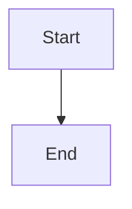

# mddoco

A CLI tool that converts markdown files to a single HTML (or future PDF) document.

[](https://github.com/massyn/mddoco/actions/workflows/ci.yml) 
 
## Installation

```bash
pip install mddoco
```

Or for development:

```bash
pip install -e .
```

> **Playwright (Chromium) is required for PDF output only.** HTML output works without it.
> The `playwright` Python package is installed automatically, but the Chromium
> browser it drives is not. The first time you render a PDF, mddoco downloads
> Chromium for you (~150 MB, one time). To do it ahead of time, or if the
> automatic download fails, run it yourself:
>
> ```bash
> playwright install chromium
> ```

## Usage

```
mddoco [OPTIONS] INPUT_PATH
```

`INPUT_PATH` can be a **directory** (all `*.md` and `*.md.j2` files are found recursively and sorted together) or a **single `.md` or `.md.j2` file**.

### Options

| Option | Short | Default | Description |
|---|---|---|---|
| `--output PATH` | `-o` | `.` | Directory to write the output file |
| `--format [html\|pdf]` | `-f` | `html` | Output format |
| `--title TEXT` | `-t` | _(none)_ | Document title shown at the top of the page |
| `--theme NAME` | | `default` | Theme to use for rendering |
| `--toc / --no-toc` | | off | Generate a table of contents |
| `--toc-depth N` | | `3` | Maximum heading depth included in the TOC (1–6) |

### Examples

Convert all markdown files in a directory:

```bash
mddoco ./docs
```

Convert a single file:

```bash
mddoco README.md
```

With a title, TOC, and custom output directory:

```bash
mddoco ./docs --title "My Project" --toc --output ./out
```

## Output

All matched markdown files are combined into a single HTML document in the output directory. The filename is derived from the input folder or file name.

## Examples

The [`examples/`](examples/) directory contains five runnable input folders, each
covering a different feature:

| Folder | Demonstrates |
|--------|--------------|
| [`examples/01_basic`](examples/01_basic) | Plain Markdown, file ordering, underscore-excluded files |
| [`examples/02_rich_content`](examples/02_rich_content) | Mermaid diagrams, syntax highlighting, `graph` charts |
| [`examples/03_themed_report`](examples/03_themed_report) | Themes and a table of contents |
| [`examples/04_jinja_data`](examples/04_jinja_data) | Jinja2 templates with JSON and CSV data files |
| [`examples/05_security_findings`](examples/05_security_findings) | CSV data grouped in a Jinja2 template and fed into a `graph` chart |

```bash
mddoco examples/03_themed_report --theme professional --title "Q3 Platform Review" --toc --output ./out
```

See [`examples/README.md`](examples/README.md) for the full list of commands.

## Jinja2 templates

Files ending in `.md.j2` are Jinja2 templates that produce Markdown. They are sorted alongside regular `.md` files (numeric prefixes such as `01_`, `02_` determine order) and converted through the same pipeline.

### Context variables (JSON and CSV)

Place `*.json` or `*.csv` files in the same input directory. Each file's stem becomes a top-level variable in the Jinja2 context — `report.json` is available as `report`, `people.csv` as `people`, and so on. If both `data.json` and `data.csv` exist, the tool will exit with an error.

```
docs/
  01_intro.md
  02_summary.md.j2    ← Jinja2 template
  report.json         ← available as {{ report }}
  people.csv          ← available as {{ people }}
```

**JSON** files are loaded as-is; the variable holds whatever structure the JSON contains.

**CSV** files are loaded as a list of row dicts, one dict per row:

```markdown

- {{ person.name }} ({{ person.role }})

```

Cell values containing `;` are automatically split into a list:

```csv
name,skills
Alice,python;flask;sql
Bob,java
```

```markdown
{{ people[0].skills }}   {# → ["python", "flask", "sql"] #}
{{ people[1].skills }}   {# → "java" (plain string — no ;) #}
```

Quoting a field in the CSV prevents `;` splitting — `"python;flask"` remains a single string.

### Excluding files

Files whose name starts with `_` are excluded from scanning. Use this for Jinja2 macro files that should be imported but not rendered as documents:

```
docs/
  _macros.j2          ← excluded; safe to use with 
  01_intro.md
  02_report.md.j2
```

### Using macros

Use `` or `` to make macros from another file callable — **not** ``. `` injects rendered output only; macros defined in an included file are not visible to the calling template and will raise an `undefined` error.

```jinja
{# correct — macro is callable after this #}

{{ macros.val(item) }}

{# also correct #}

{{ val(item) }}

{# wrong — val will be undefined #}

{{ val(item) }}
```

## Themes

Themes are Jinja2 HTML files with embedded CSS. Pass a theme name with `--theme NAME`. The `-wide` and `site-*` themes extend another theme (`default.html`, `_site_base.html` and so on), so to customise one of those, copy the theme it extends as well.

| Theme | Description |
|---|---|
| `default` | Clean GitHub-style layout, 860 px centred column |
| `default-wide` | Same as `default` but full viewport width |
| `professional` | Corporate blue palette, dark title banner, card layout, 900 px centred |
| `professional-wide` | Same as `professional` but full viewport width |
| `dark` | Dark background, blue accent, light text — good for technical docs, 860 px centred |
| `dark-wide` | Same as `dark` but full viewport width |
| `academic` | Serif (Georgia) typography, justified text, print-optimised, 720 px centred |
| `academic-wide` | Same as `academic` but full viewport width |
| `vanilla` | Minimal HTML with no styling — useful for testing or custom CSS |
| `paged-professional` | Corporate style with Paged.js pagination for print-ready PDFs |
| `site` | Website layout: side nav with one page per H1, minimalist styling (HTML only) |
| `site-professional` | Same as `site` with a navy sidebar and card layout (HTML only) |
| `site-dark` | Same as `site` on a dark background (HTML only) |
| `site-terminal` | Same as `site` as a green-phosphor terminal, just for fun (HTML only) |

All themes support:

- Optional document title
- Optional table of contents (the `site-*` themes use their side nav instead)
- [Mermaid.js](https://mermaid.js.org) diagram support (loaded only when diagrams are present)
- Graph diagram blocks

### Site themes

The `site-*` themes turn the output into a small website while keeping it a single HTML file: no web server needed, and it still works offline or as an email attachment.

```bash
mddoco ./docs --theme site --title "Team Handbook" --output ./out
```

- Every H1 starts a new page, and each page is listed in the side nav. Anything before the first H1 becomes an introduction page.
- The current page's H2 headings are listed under it in the nav.
- Only one page shows at a time, with previous/next links at the bottom. Each page has its own address (`handbook.html#/onboarding`, or `#/onboarding/first-week` for a heading), so the back button, bookmarks and shared links work.
- On narrow screens the nav moves behind a menu button.
- They are screen-only: `--format pdf` is refused. Printing from the browser still prints every page in sequence.

### Screen-only custom themes

A custom theme can refuse PDF output by declaring this at the top level of its template:

```jinja

```

`--format pdf` with that theme then exits with an error instead of producing a PDF.

### Graph diagrams

Use ` ```graph ` fenced blocks with a JSON payload. The only required field is `data`.

**Minimal example** — all defaults applied:

````markdown
```graph
{
  "data": {
    "x": ["Jan", "Feb", "Mar"],
    "Sales": [100, 150, 120]
  }
}
```
````

Series are inferred from the data keys (everything except `x`). Each series defaults to a line chart in blue.

**Full schema:**

| Field | Required | Default | Description |
|---|---|---|---|
| `data.x` | yes | — | Category labels |
| `data.<name>` | yes | — | Values for each series (one key per series) |
| `title` | no | _(none)_ | Chart title |
| `orientation` | no | `vertical` | `vertical` or `horizontal` |
| `show_legend` | no | `true` | Show the legend |
| `width_px` | no | `640` | Width in pixels |
| `height_px` | no | `480` | Height in pixels |
| `min` / `max` | no | — | Axis bounds |
| `series` | no | _(auto)_ | Override series definitions (see below) |

**Series fields** (all optional when auto-generated):

| Field | Default | Description |
|---|---|---|
| `label` | _(data key)_ | Must match a key in `data` |
| `type` | `line` | `bar`, `line` (solid), or `line2` (dotted) |
| `colour` | _(palette)_ | Colour string, or list of colours per bar |
| `marker` | `false` | Show point markers (line types only) |

**Full example:**

````markdown
```graph
{
  "title": "Sales vs Target",
  "orientation": "vertical",
  "show_legend": true,
  "data": {
    "x": ["Jan", "Feb", "Mar", "Apr", "May"],
    "Sales":  [85, 92, 78, 96, 110],
    "Target": [90, 90, 90, 90, 90]
  },
  "series": [
    { "label": "Sales",  "type": "bar",  "colour": "#3498db" },
    { "label": "Target", "type": "line", "colour": "#e74c3c", "marker": false }
  ]
}
```
````

### Mermaid diagrams

Use standard fenced code blocks in your markdown:

````markdown

````

mddoco detects mermaid blocks automatically and loads the Mermaid.js CDN only when needed.
